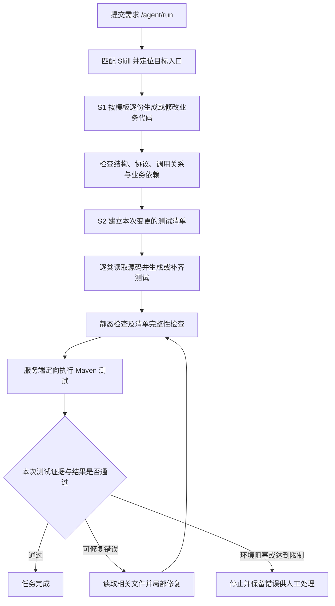

# S1 / S2 功能进展与下一期迭代计划

> 报告日期：2026-11-10  
> 项目：基于 Skill 和模板的目标工程代码自动生成与改造服务  
> 依据：当前实现、已有设计与实施记录，以及 `logs/mini-codex.log` 中 2026-11-10 16:13:52～16:17:49 的实际任务记录。本文编写过程未重新编译、执行测试或发起模型调用。

## 一、汇报结论

项目已实现从“输入需求”到“定位目标工程、按模板生成或修改代码、生成测试、执行验证、失败后有界修复”的主流程。

- **S1：模板驱动的业务代码生成与改造已跑通代表场景。** 按模板顺序读取、实施和检查，支持已有文件局部修改及业务依赖补齐。本次总览及五个实现模板完成，随后才进入 S2。
- **S2：本次已验证“生成测试 → 执行失败 → 自动修复 → 重新测试 → 通过”的闭环。** 七个测试类共 61 个用例，执行三次 Maven、经历两轮修复，最终 61 个通过、0 失败、0 错误、0 跳过，异步任务成功。
- **验收范围：本次验证的是预测接口场景及测试代码修复。** 两轮实际补丁均修改 `HttpClientUtilTest.java`，尚不能作为业务代码缺陷自动修复、多 Skill 或全项目回归通过的证据。
- **下一期重点从“跑通”转向“稳定复现与扩大验收”。** 优先验证真实业务缺陷修复、其他 Skill 的端到端行为，以及需求场景和测试证据的对应关系，再持续优化成本和报告。

### 可直接用于口头汇报

> 本阶段完成了基于 Skill、分块模板和程序门禁的代码生成与测试修复流程。S1 按模板逐步生成或修改代码，通过 JavaParser 检查类型、协议和调用关系，并结合依赖映射补齐 POM。S2 根据本次变更和真实源码生成测试，结合业务验收规则检查测试质量，由服务端运行 Maven，并以本次 Surefire 报告判定结果。本次预测接口任务经历两轮测试修复、三次实际测试，最终 61 个用例全部通过，约耗时 3 分 57 秒。下一期重点是稳定复现、验证业务代码缺陷的自动修复，以及其他 Skill 的端到端验收。

## 二、整体流程和职责划分



模型负责理解需求、生成修改计划和分析失败；文件操作、阶段推进、范围校验、Maven 执行及最终成功判定由服务端控制。模型不能在计划中自由执行 shell 或 Maven。

### 运行入口与环境

| 项目 | 当前能力 |
| --- | --- |
| 目标工程 | 通过 `codex.workspace.root` 指向待改造项目 |
| 模板与 Skill | 从生成器本项目读取，业务源码从目标 workspace 读取，避免混用路径 |
| 单任务入口 | `POST /agent/run` 异步提交，返回任务 ID；通过 `GET /agent/task/{taskId}` 查询 |
| 需求范围 | 以已匹配的业务 Skill 为入口，当前重点验证预测接口改造场景；未匹配需求不直接执行自动开发 |
| JDK 隔离 | 生成器使用 JDK 8，当前目标工程使用 JDK 11；`codex.agent.test-java-home` 仅影响目标 Maven 子进程 |
| 日志 | 阶段、模型调用、工具操作、Maven 输出及失败原因写入 `logs/mini-codex.log`；服务重启时覆盖旧日志 |

## 三、S1 已实现功能：按模板生成与改造业务代码

### 1. 按模板顺序实施

预测接口场景按照“总览 → 请求实体 → 配置 → HTTP 工具 → 调用 Handler → 业务入口”推进。先读取当前模板，完成对应产物并通过检查，再处理下一份模板；避免将所有模板一次性塞入模型上下文。

| 模板阶段 | 主要交付内容 |
| --- | --- |
| 请求实体 | 请求体、请求头和业务数据实体，明确字段类型及 JSON 协议映射 |
| 配置 | 接口地址、超时、连接池和重试等配置项及配置类 |
| HTTP 工具 | 统一 HTTP 调用、连接管理及公共追踪组件接入 |
| 调用 Handler | 请求构建、统一调用及响应结构解析 |
| 业务入口 | 在已有入口中接入调用链，并按固定方式写回结果字段 |

### 2. 模板要求通过检查落地

- 检查真实 package、同名类型、必需字段、方法及关键调用，不能仅靠模型声称完成推进阶段。
- 请求实体保留 `@JsonProperty` 映射；请求头 `isTestEvent` 固定为 `Boolean`，与布尔值调用一致。
- 自助设备地址使用 `SLF_EQP_ADR` 协议键，检查实体字段与 Handler 的真实 setter，防止拼写不一致或新增重复协议字段。
- HTTP 工具检查公共追踪类型、真实 Bean 字段、适配器与追踪调用，拒绝生成业务包中的公共组件替身。
- 入口保留固定调用链、响应取值和 `eventData.putDataAndOriginData` 写回方式。
- 评分等精度敏感数据要求使用 `BigDecimal`，检查异常响应下的失败回写，避免浮点转换或部分成功数据残留。

这些属于静态结构与契约检查，能提前发现已知偏差，但不等价于完整 Java 编译、任意业务语义正确或生产可用性证明。

### 3. 已有文件局部修改

- 新文件确认不存在后创建；已有源码、配置和 POM 先读后使用局部补丁修改，不因文件存在就停止，也不直接整文件覆盖。
- 补丁旧文本必须匹配真实且唯一的内容；同一文件多个补丁按计划顺序预演，预检拒绝时不执行该计划。
- 补丁上下文不一致时提供真实内容摘录；针对匹配失败，可在任务内对相应文件安排一次确定性刷新读取。

### 4. S1 同步识别业务依赖

- 根据当前模板实际 import、模块 POM 和可访问的本地父链判断依赖缺项，不把已知缺包全部留给 S2。
- 使用 `.ai/dependency-mappings.properties` 提供公共包坐标及已知提供方线索，已覆盖 Jackson、Gson、HttpClient、Commons Lang、OpenTracing 等相关依赖。
- 区分实际依赖与 `dependencyManagement`；仅有版本管理、test/runtime 声明不能直接视为业务编译依赖已满足。
- 优先复用已有版本管理，只局部补入口模块 POM；未知私有依赖坐标或版本不能编造，父 POM 保持只读。

当前依赖判断以静态解析和明确映射为主，尚不等价于 Maven 完整有效配置及传递依赖解析。

### 5. 普通业务 Skill 的阶段约束

除预测接口固定模板外，普通业务 Skill 已增加独立的 `BusinessSkillContractValidator`。程序依据命中 Skill 检查入口、字段处理、实际调用及写回；通用外调场景进一步检查配置、Client、DTO、工厂与入口调用链，不能只写一个文件就宣称 S1 完成。

`SkillLoader` 解析规则及 `Acceptance` 验收条目；`SkillMatcher` 统一匹配和加载顺序，任务上下文与规划器复用同一组命中结果。多入口需求逐一核实，支持搜索后读取，也支持直接读取合法的真实入口。检查只基于任务已知源码和适用配置，不无界扫描整个工程。

以上为已落地能力；字段截取、严格日期转换、IP 字段加工、RTD 返回加工、通用外调和组合需求，仍需分别进行实际端到端验收，本次预测接口成功不能代替这些场景的运行证明。

## 四、S2 已实现功能：测试生成、执行与有界修复

### 1. 从本次变更建立测试清单

从当前任务成功修改的业务 Java 文件建立入口模块内的测试清单，逐类读取真实源码及已有测试，再生成或局部补齐当前测试。接口、抽象类等不适合作为独立条目的类型记录跳过理由。

已有测试可以复用和补齐，不要求无意义重写。当前清单以本次成功修改文件为基础，尚未覆盖任意跨模块影响分析。

### 2. 测试结构与修改范围保护

- 支持已有 JUnit 4/5 测试，检查真实包名、类名、业务类引用、测试方法及断言或交互验证。
- 拒绝空壳、禁用、assumption 跳过以及仅靠常量断言冒充有效测试。
- 修复时保护既有测试方法和有效断言，禁止删除或放宽断言制造通过；已知非法 API 或与真实源码矛盾的交互预期，只能按具有限定条件的修正规则处理。
- 外部 HTTP、数据库及私有服务优先使用 Mock 隔离，不要求连接真实外部服务。
- 测试依赖从模块 POM 局部补充；支持 Mockito inline、版本依据及静态初始化隔离检查，本次场景已实际通过，其他依赖组合仍需验收。
- 区分实例字段与静态字段、首次类加载与显式初始化，防止反射注入错误、无效工厂重配桩及构造器 Mock 引用不可见类型。
- 预测响应场景检查真实输入到调用的关联：非法 JSON、缺响应头、缺评分/耗时、非法数值及小数精度等，不能仅靠测试方法名或孤立断言视为覆盖。

正常、异常、空值和需求分支覆盖已纳入生成规则；目前没有覆盖率指标证明所有业务分支均已覆盖。

### 3. 服务端定向执行 Maven

全部清单条目通过检查后，由服务端对固定模块及明确的测试类清单执行 Maven，不回退为无范围的全量测试。

- Maven 参数由系统构建，模型不能自由拼命令。
- 已处理旧版 Maven 不支持 `-ntp` 的兼容问题，保留异常链输出。
- 支持目标 JDK 配置、子进程编码统一、并发读取输出、执行超时及本次进程树清理逻辑。
- 编译或 POM 阶段失败时明确说明测试尚未启动，避免给每个测试类追加缺少报告的次生错误。

### 4. 以本次报告判定测试结果

通过运行前后文件指纹检查 Surefire XML 是否属于本次执行，逐个核实预期测试类的有效用例；旧报告、未执行、全跳过不能作为成功依据。

成功判定需要 S1 契约、测试清单、Maven 退出结果及本次有效测试证据共同满足。结论只覆盖当前模块指定清单，不代表目标项目全量回归通过。

### 5. 失败后的有限轮次修复

可修复错误进入 REPAIR，读取相关业务类、测试和 POM 后局部修改，再重新检查和执行。缺少工具、仓库鉴权及资源处理等环境阻塞及时停止，避免盲改业务。

| 控制项 | 当前配置或行为 |
| --- | --- |
| S2 开关 | `codex.agent.test-generation-enabled`，当前项目配置为 `true` |
| 总规划预算 | `codex.agent.max-model-calls`，当前 40 次，S1/S2 共用 |
| 修复轮数 | `codex.agent.max-repair-rounds`，当前 5 轮，可配置 0～10 |
| 单次测试超时 | `codex.agent.test-timeout-seconds`，当前 300 秒，可配置 30～1800 |
| 重复失败 | 同一错误且文件无实质变化时提前停止；连续规划失败也有停止保护 |
| 错误反馈 | 本次报告异常详情去重、控制台关键根因保留、摘要有界并脱敏 |

## 五、技术架构与关键实现方案

### 1. 技术组成及职责分工

整体采用“模型输出结构化计划，程序校验并执行，实际运行结果驱动修复”的方案。

| 技术点 | 实现方式 | 解决的问题 |
| --- | --- | --- |
| 服务与任务入口 | Spring Boot REST 接口，单任务异步执行并提供状态查询 | 避免多轮模型调用阻塞请求导致网关超时 |
| 阶段编排 | `AgentLoop` 配合 `AgentContext`、`AgentPhase`、`CodingTrack` | 分离分析、S1、S2、验证、修复和结束，防止未生成完就执行测试 |
| 模型规划 | `QwenPlanner` 组装需求、规则和文件观察，解析 JSON 工具计划 | 把自然语言需求转成可检查的具体文件操作 |
| 业务知识约束 | 项目业务 Skill 加 Markdown 分块模板 | 明确业务写法、模板顺序、固定协议及调用方式 |
| 需求验收传递 | `SkillLoader` 解析 Acceptance，`SkillManager` 向 S2 提供命中 Skill 的 Rules、Acceptance、Forbidden | 让测试同时依据业务预期和真实实现，避免只照源码生成自洽测试 |
| Java 静态解析 | JavaParser AST，结合必要的文本、配置及 XML 检查 | 检查真实类型、字段、方法、注解和调用，而非只搜索关键词 |
| 文件修改 | 工具白名单、workspace 路径约束、先读后改、唯一旧文本匹配及计划预演 | 控制修改范围，防止覆盖已有实现或使用过期内容 |
| 依赖识别 | import 解析、包名前缀坐标映射、模块及本地父 POM 解析 | 在 S1 提前发现已知公共依赖缺项 |
| 测试与执行 | JUnit 4/5、Mockito、Maven Surefire；服务端 `ProcessBuilder` 启动 Maven | 使用目标工程已有构建方式执行明确的测试清单 |
| 结果证据 | Surefire XML、安全 XML 解析、运行前后报告指纹 | 区分实际执行、旧报告、跳过、失败和通过 |
| 修复控制 | 错误反馈、文件最新读取、契约重验、修复上限与重复失败保护 | 避免无限修复和通过破坏业务约束来迁就测试 |
| 模型接入与观测 | `LlmClient`、`ChatCompletionClient` 复用聊天请求链路，记录角色、调用次数、Token 及输入字符分布 | 减少重复接入配置，定位上下文和重试成本；模型不接管执行门禁 |

### 2. Skill、模板、执行计划与测试清单的区别

| 概念 | 当前含义 | 由谁维护或生成 |
| --- | --- | --- |
| 业务 Skill | 业务匹配条件、目标入口、规则、Acceptance 及模板路径，例如 `predict-api` | 项目维护者配置 |
| 模板 | 业务代码结构、字段映射、配置与调用示例 | 项目维护者配置 |
| 工具执行计划 | 本轮需要调用哪些工具、修改哪个文件、使用什么补丁 | 模型生成，程序校验 |
| S2 测试清单 | 本次需生成或补齐哪些类的测试，以及条目进度 | 程序从任务变更记录建立 |
| 测试用例 | 测试方法、输入数据、Mock 和断言 | 模型根据需求、真实源码及规则生成 |

**当前测试计划并不是独立 Skill。** 通用测试生成规则由 S2 程序提供，业务 Skill 的 Rules、Acceptance 和 Forbidden 已传递到测试生成及修复阶段；不把 S1 的 Implementation 步骤整段带入 S2。清单推进、测试执行和成功判定仍由程序负责。

### 3. S1 顺序生成与校验方案

1. 匹配业务 Skill，通过搜索后读取或直接有效读取定位真实目标入口，确定包路径和所属模块；多个入口分别核实。
2. `SkillTemplateCoordinator` 确定当前模板，并保留总览、当前模板及当前产物的必要上下文。
3. 模型生成当前模板的工具计划；程序检查阶段、路径、已有文件读取状态及补丁匹配情况。
4. 工具执行后，`TemplateContractValidator` 检查实际落盘产物，`MavenDependencySupport` 检查相关业务依赖。
5. 检查通过后将模板记入 `completedTemplates`；不通过则反馈具体缺项，继续处理当前模板。

不是“读取过模板就完成”，也不是“模型返回空计划就完成”；阶段由程序依据产物和契约推进。现有模板检查包含场景特定规则，并非任意模板均能自动推导出完整约束。

### 4. 测试生成的数据来源与上下文方案

测试生成依据是“原始需求 + 命中 Skill 的业务验收 + 当前真实业务源码及已知复用 API + 已有测试 + 模块依赖 + S2 生成规则”，修复阶段再加入具体失败信息。

```text
S1 成功的文件操作
    ↓ 记录路径、工具输入、结果和成功状态
当前任务 AgentContext.observations
    ↓ 提取入口模块 src/main/java 内的本次变更，规范化路径并去重
S2 测试清单：source / sourceClass / test / testClass / complete
    ↓ 按当前条目读取实际文件，检查已有读取是否仍匹配磁盘内容
当前业务源码/复用 API + 已有测试 + 模块 POM + 原始需求/Skill 验收/生成规则
    ↓ 模型生成 JSON 工具计划
生成或局部补齐测试 → AST 检查 → 推进下一条目
```

S1 的变更记录用于确定“测哪些类”，不把旧的生成响应直接视为最终源码。S2 会读取磁盘中的实际实现，并将读取结果作为模型观察上下文；任务已知且实际复用的支持类保留 API 上下文，但不会因为只读过就额外加入本次测试清单。相关状态保存在当前任务上下文中，不是另建一份测试计划数据库。

`QwenPlanner` 在 S2 优先保留当前清单条目的源码、测试和 POM 观察，结合少量最近操作；文件内容超限时标记截断，要求补读。REPAIR 根据错误涉及的类保留相关文件，不一次性重新加载全部业务模板。

**当前已有文本形式的 Skill 验收要求，但尚无通用的“验收场景 → 测试方法 → 本次执行证据”强制映射。** 特定模板已增加响应和精度场景的源码证据门禁，仍不能证明任意需求均已完整覆盖。下一期应将业务验收独立编号并关联实际测试结果；源码提供真实签名，验收场景提供预期结果。

### 5. Java 导包与 Maven 依赖解析方案

当前采用“模板与模型补 import + 程序查映射及已有声明 + Maven 实际验证”的协作方式，不完全依赖模型推理，也不是完整的 IDE 符号解析器。

| 问题 | 当前处理方式 |
| --- | --- |
| 某个类型应使用哪个 Java import | 优先依据模板中的公共类型和已读目标源码，由模型补齐；部分固定公共类型有专门契约检查 |
| import 所属的 Maven 坐标 | 程序解析实际 Java import，按最长包名前缀匹配 `.ai/dependency-mappings.properties` |
| 模块是否已经具备依赖 | 解析入口模块及 workspace 内可访问的本地父 POM，检查直接/继承声明、scope 和已知提供方 |
| 缺少依赖如何修改 | 将缺项及候选坐标反馈模型，由模型基于已读 POM 生成局部补丁 |
| 版本如何确定 | 优先已有版本、properties、父 POM/BOM 管理；未知版本或私有坐标必须有依据 |
| 最终是否可用 | Maven 根据实际构建配置解析依赖并编译，验证类型及方法能否解析 |

例如实际源码出现：

```java
import org.apache.commons.lang3.StringUtils;
```

程序可匹配已维护的映射：

```properties
org.apache.commons.lang3.=org.apache.commons:commons-lang3
```

若适用依赖已存在则复用；若缺失则要求局部补模块 POM。部分映射包含多个已知提供方，表示存在适用提供方时可复用，不是全部添加。

技术边界：静态检查不解析完整远程 BOM、所有传递依赖和任意动态激活的 profiles；配置检查只合并有明确激活依据的配置，不把互斥环境随意拼接。只在 `dependencyManagement` 中声明坐标不能视为实际引入。映射外公共包及私有包仍需根据项目资料分析，不能从 Java 包名直接猜 Maven 坐标。S2 测试依赖仍结合生成规则、模型分析和实际错误反馈，不能替代 Maven 的最终解析。

### 6. 为什么使用 Maven，以及谁判断测试通过

目标工程本身使用 Maven，因此直接复用 POM 中的编译、依赖和 Surefire 配置。Maven 的作用是统一、可重复地组织构建和执行，测试质量仍由需求场景、断言及 Mock 的正确性决定。

- **JUnit** 执行测试方法和断言。
- **Mockito** 隔离外部依赖及指定对象行为；静态、构造器 Mock 需要实际 MockMaker 支持。
- **Maven / Surefire** 组织编译和测试执行，输出退出码及结构化测试报告。
- **服务端程序** 根据退出码、新报告、预期测试类和有效用例判定结果。
- **模型** 接收失败详情，提出业务代码、测试或依赖的修复计划，不拥有最终成功判定权。

服务端命令形态如下，仅用于说明当前方案，本文未执行该命令：

```text
mvn -B -e test -Dtest=<本次测试类全名清单>
    -DfailIfNoTests=true -Dsurefire.failIfNoSpecifiedTests=true
    -DskipTests=false -Dmaven.test.skip=false -Dmaven.test.failure.ignore=false
    -Dstyle.color=never
```

运行前保存报告时间、长度和内容哈希等指纹，运行后核对新报告。指定类没有本次有效执行证据，即使退出码为零也不能报成功；模型声称“已经修复”同样不能替代重新执行。

### 7. 错误反馈、修复与资源控制

失败信息来自静态检查、Maven 输出和本次 Surefire XML。程序对已知命令参数、POM、资源阶段、编译和测试失败分别处理；环境阻塞停止，允许修复的问题反馈给模型。

报告异常类型与消息按有界长度提取并去重，MockMaker 等没有 Maven ERROR 前缀的关键信息单独保留；避免模型只看到“某用例失败”而缺少根因。修复后先重新检查 S1 契约及 S2 测试结构，再执行测试。

Windows 通过监督进程管理 Maven，生成器使用 JDK 8 兼容的进程 API；读取线程持续消费输出，避免输出管道阻塞。目标 JDK 通过子进程环境设置，不修改生成器运行基线或全局 Java 环境。超时和中断只清理本次进程树。

测试清单、文件、报告和日志摘要均有边界：最多 200 个源码条目、单个源码文件 256 KiB/10000 行、最多 200 份报告且每份 1 MiB、模型错误摘要最多 8 KiB；同时受总模型预算和修复轮数限制。这些是控制成本和异常资源占用的措施，不代表已有成本优化目标全部达成。

### 8. 日志、诊断快照与上下文成本

- Skill 和 planner 日志只记录命中项、路径和执行摘要，不打印完整正文；保留模型调用次数、阶段、轮次和文件操作结果。
- S2 使用同一 `flow` 串联“测试预检 → Maven → 失败类/方法/根因 → 修复计划接受或拒绝 → 补丁结果 → 重测 → 最终证据”。`round` 表示修复轮次，`attempt` 表示验证次数，规划重试不会自动等同于一次 Maven 执行。
- 预检拒绝的候选测试未写入目标工程时，可将候选源码保存到生成器的 `logs/s2-preflight/*.java.txt`，日志只打印路径；每任务最多保留三份候选，每份最多 256 KiB，便于核实门禁误判或模型错误。
- 去重重复规则和依赖坐标展示，显式提供文件已读范围，S2 复用相关源码和 POM；保留必要模板、源码及补读能力，不以删减验收条件换取成本下降。
- 模型日志分别记录 input/output/total Token、服务商返回的缓存命中/未命中 Token，以及各提示词区块字符数。字符数不是 Token，缓存统计不能直接换算为费用；没有同条件对照运行时不承诺节省比例。

## 六、当前进展与运行证据

| 能力 | 实现状态 | 当前证据与结论 |
| --- | --- | --- |
| S1 顺序模板与产物检查 | 代表场景通过 | 总览及五份实现模板完成，随后建立 S2 清单 |
| S1 业务生成与局部修改 | 代表场景通过 | 新建实体、配置、HTTP 工具及 Handler，修改入口、YAML、POM；后续实际编译及指定测试通过 |
| S2 逐类测试生成与预检 | 代表场景通过 | 七个条目达到 7/7；候选不合格时反馈并重新规划，而不是提前执行 Maven |
| S2 定向执行与报告识别 | 代表场景通过 | 三次 Maven 均实际执行 61 个用例，最终七份本次报告，61 通过、0 跳过 |
| S2 自动修复与重新验证 | 测试代码修复闭环通过 | 两轮实际测试补丁后，第三次 Maven 通过并记录 task success |
| 普通 Skill 的 S1/S2 约束 | 代码已落地，待逐场景验收 | 已传递业务 Acceptance 并增加普通产物门禁；本次未验证其他业务 Skill |
| 业务生产代码缺陷的自动修复 | 主流程具备，专项验收待补 | 本次两轮修复只改测试源码，不能替代生产缺陷修复证据 |

### 最新一轮：2026-11-10 16:13:52～16:17:49

- 需求：`外调模型接口`；命中 `predict-api` 与 `common-file-editing`。
- 任务 ID：`a05619e0a866459e9ac365627a5f6356`；流程 ID：`81cac734`。
- 目标工程：`D:\ideaProject\target\LW45.07_RT_PfPlugin`；模型：`deepseek-flash`。
- 任务执行约 236.949 秒；模型调用 19/40 次，修复轮次 2/5。

| 时间 | 阶段 | 日志证据与结果 |
| --- | --- | --- |
| 16:13:52.436 | 任务启动 | 异步任务开始，S2 已开启 |
| 16:13:54.738～16:14:38.570 | S1 | 六个模板阶段依次记录 `S1 template completed`，从总览推进至入口映射 |
| 16:14:38.617 | 转入 S2 | 建立 `entries=7` 的测试清单，无跳过条目 |
| 16:15:49～16:16:49 | 测试生成纠偏 | 三次候选预检拒绝：响应场景未取得关联证据、实例字段被当成静态字段注入；候选保留诊断快照，继续规划 |
| 16:17:08.633 | 测试预检完成 | 七个条目均通过源码预检，开始第一次完整验证；此时才进入 Maven 执行 |
| 16:17:10.074～16:17:19.883 | 首次 Maven，round=0 / attempt=1 | 实际执行 61 个用例，60 通过、1 失败、0 跳过，退出码 1 |
| 16:17:19.893～16:17:26.899 | 第一轮修复 | 第 17 次规划被预检拒绝；第 18 次计划通过，局部修改 `HttpClientUtilTest.java`，进入重新验证 |
| 16:17:28.014～16:17:36.121 | 第二次 Maven，round=1 / attempt=2 | 再次实际执行 61 个用例，仍是 60 通过、1 失败；没有将“已打补丁”视为修复成功 |
| 16:17:36.125～16:17:40.190 | 第二轮修复 | 第 19 次规划通过，继续局部修改同一个测试文件，再次验证 |
| 16:17:41.299～16:17:49.383 | 第三次 Maven，round=2 / attempt=3 | 61 个用例全部通过，0 失败、0 错误、0 跳过；七份报告，`BUILD SUCCESS`、`problems=0` |
| 16:17:49.385 | 任务结束 | `agent async task success taskId=a05619e0a866459e9ac365627a5f6356` |

**因此，日志完整体现了 S1 生成 → S2 生成测试 → 测试报错 → 修复 → 再次报错 → 再修复 → 测试通过。** 生成阶段的三次预检拒绝、修复阶段的一次计划拒绝与实际 Maven 失败是不同事件，不能混为“执行了多轮测试”。

### 本次具体失败和修复含义

前两次实际失败均为 `HttpClientUtilTest#shouldReinitializeConnectionManagerWhenInitCalled`：Mockito 报 `WantedButNotInvoked`，测试预期调用 `SpringContextBeanUtil.getApplicationContext()`，但本轮没有该交互。

结合当前真实源码，Bean 获取发生在 `HttpClientUtil` 的静态字段初始化；`init()` 使用已缓存的 `readConfig` 设置连接池容量，不会每次重新从 Spring 取 Bean。类加载已完成后，要求显式 `init()` 再次触发该交互，与实现生命周期不一致。第一轮补丁未消除这个错误预期，因此重测仍失败；预检反馈中的“清空调用后保留精确次数验证”也未有效解决根因，需要作为后续诊断策略的改进样例。

最终测试显式调用真实 `HttpClientUtil.init()`，保留对象和连接池非空检查，以及最大连接数 200、单路由连接数 50 的实际结果断言；错误的 Bean 获取交互验证已移除。这个改动属于校正不成立的测试预期，不能概括为“删除断言即可通过”，也不能据此宣称生产逻辑经过自动纠错。进一步应使用不同于初始化默认值的配置输入，确认容量断言确实能发现 `init()` 不生效的缺陷。

本次最终用例分布：

| 测试类 | 执行数 | 最终结果 |
| --- | --- | --- |
| `AhiHttpBodyHeaderEntityTest` | 8 | 全部通过 |
| `AhiHttpBodyDataEntityTest` | 8 | 全部通过 |
| `AhiHttpBodyEntityTest` | 8 | 全部通过 |
| `ReadConfigTest` | 5 | 全部通过 |
| `HttpClientUtilTest` | 6 | 全部通过 |
| `AhiHttpInvokerHandlerTest` | 14 | 全部通过 |
| `DataPrepEventHandlerTest` | 12 | 全部通过 |
| **合计** | **61** | **失败 0、错误 0、跳过 0** |

日志仍包含 IO 失败、非法 JSON 等异常路径的堆栈，这是负例测试触发的业务日志；不能仅凭出现 ERROR 字样认定最终任务失败。测试结果以本次 Surefire 统计和服务端验证结论为准，同时应继续改善负例日志与真实失败诊断的区分。

### 当前尚不能承诺的事项

- 任意自然语言需求均可自动开发；当前能力受已配置 Skill 和模板覆盖范围约束。
- 所有模板语义和业务分支均被静态检查或测试完全覆盖。
- 每次任务都能在预算内自动修复到通过。
- 多模块、真实外部系统集成和目标项目全量回归已经验收。

## 七、下一期迭代计划（建议）

本次已完成代表场景的测试修复闭环。下一期保持代码质量和验收强度，先稳定现有流程、验证其他已实现 Skill，不以提高调用预算代替根因修复。

| 优先级 | 工作项 | 计划内容 | 验收标准 |
| --- | --- | --- | --- |
| P0 | 业务缺陷修复专项验收 | 在隔离样例中引入已知业务缺陷，要求保留正确测试并修复生产代码，再验证失败和通过证据 | 日志明确显示业务源码补丁及重测通过，不能通过放宽测试掩盖缺陷 |
| P0 | 闭环重复性与其他 Skill 验收 | 固定需求和目标初态重复发单；覆盖已有文件修改、字段截取、日期、IP、RTD、通用外调及组合需求 | 各场景均核实 S1 产物、S2 测试和本次报告；记录成功率、失败分类和人工介入原因 |
| P0 | 修复诊断和门禁准确性 | 区分静态类加载、显式 init、实例字段、错误测试预期与真实业务错误；审查候选快照中的响应证据拒绝 | 合法夹具可通过，错误交互有源码依据才可修正；不再只补 clearInvocations 后重复相同失败，不放宽有效断言 |
| P0 | 需求验收证据关联 | 将已配置 Acceptance 编号，关联输入、预期结果、测试方法与本次报告；加强可发现缺陷的测试数据 | 场景不只存在于提示词；能定位执行证据，初始化测试使用有区分度的配置并能发现无效 init |
| P1 | 测试依赖与环境兼容 | 持续验证 JUnit、Mockito 静态/构造器 Mock、目标 JDK、父级版本和本地仓库组合 | 依赖修复有真实依据，环境阻塞单独报告，不盲改生产逻辑或无依据升级版本 |
| P1 | S1 契约持续完善 | 将验收发现的字段、调用及依赖偏差补充为可复用检查，保持逐模板实施 | 已知模板偏差能在进入测试执行前被发现，已有业务逻辑和注释保持完整 |
| P1 | 上下文与调用成本 | 分析当前 prompt、重复读取及失败重试，缩减无关历史，保留当前模板和错误相关文件 | 固定场景记录调用数、输入输出 Token、耗时及失败轮数，与基线比较，不以减少必要检查换成本 |
| P1 | 任务报告与日志可读性 | 汇总修改文件、模板进度、测试统计、修复记录、未完成项及建议；区分负例异常日志和实际失败 | 能直接区分生成完成、编译通过、测试通过、测试代码修复、业务代码修复和环境阻塞 |
| 后续 | 新场景、多模块与集成验证 | 在已有 Skill 验收后评估新增模板、跨模块影响及真实外部系统集成 | 每个场景有独立契约、依赖依据和验收样例，不把单元测试通过视为集成通过 |

建议实施顺序：**固定本次成功样例 → 验证生产缺陷自动修复及门禁准确性 → 验收其他已实现 Skill → 建立重复性与成本对照 → 再扩展多模块和集成场景。** 具体排期在确定人力和验收样例后安排。

## 八、建议汇报的指标

后续每轮验收固定记录以下指标，避免只以“生成了多少文件”衡量完成度：

- S1：模板完成数、契约拒绝次数、依赖补齐次数，以及进入 S2 前的生成质量。
- S2：清单条目数、实际执行/通过/失败/跳过用例数，以及报告新鲜度。
- 闭环：首次验证通过率、自动修复成功率、平均修复轮数和人工介入原因。
- 效率：端到端耗时、模型调用次数及输入输出 Token。

现有日志可支撑部分指标的人工统计，统一看板与自动统计不计入本期已完成功能。

### 本次运行基线

| 指标 | 本次结果 |
| --- | --- |
| 模板/测试清单 | 6 个模板阶段、7 个测试类 |
| 最终实际测试 | 61 执行、61 通过、0 失败、0 错误、0 跳过 |
| 验证/修复 | 3 次 Maven、2 轮修复；首次验证未通过 |
| 模型调用 | 共 19 次：S1 含分析 6 次、S2 生成 10 次、S2 修复规划 3 次 |
| 端到端执行耗时 | 约 3 分 57 秒 |

按本次 19 条 `llm usage` 汇总服务商实际返回值：

| 阶段 | 输入 Token | 输出 Token | 总 Token |
| --- | --- | --- | --- |
| S1（含分析） | 88,970 | 10,517 | 99,487 |
| S2 测试生成 | 231,140 | 36,422 | 267,562 |
| S2 修复规划 | 97,913 | 1,054 | 98,967 |
| **合计** | **418,023** | **47,993** | **466,016** |

以上为多次请求累加的逻辑 Token，包含重复输入和缓存输入，不是单次上下文长度或实际计费金额。输入占比较高，生成预检和修复重试仍有优化空间；单次成功样例不能推导整体成功率，也不能据此断言相比历史已节省固定比例。

## 九、主要实现位置与参考资料

| 模块 | 主要文件 |
| --- | --- |
| 任务入口与状态查询 | `src/main/java/com/cmbchina/llm/controller/AgentController.java` |
| 阶段编排与修复循环 | `src/main/java/com/cmbchina/llm/runtime/AgentLoop.java` |
| 规划、规则和补丁预检 | `src/main/java/com/cmbchina/llm/planner/QwenPlanner.java` |
| S1 模板推进及契约 | `src/main/java/com/cmbchina/llm/planner/SkillTemplateCoordinator.java`、`TemplateContractValidator.java` |
| 普通 Skill 与验收上下文 | `src/main/java/com/cmbchina/llm/planner/BusinessSkillContractValidator.java`、`src/main/java/com/cmbchina/llm/skill/SkillLoader.java`、`SkillMatcher.java`、`SkillManager.java` |
| Maven 业务依赖识别 | `src/main/java/com/cmbchina/llm/planner/MavenDependencySupport.java`、`.ai/dependency-mappings.properties` |
| S2 清单与测试门禁 | `src/main/java/com/cmbchina/llm/planner/S2TestCoordinator.java`、`src/main/java/com/cmbchina/llm/verify/TestSourceInspector.java` |
| 验证、执行与测试证据 | `src/main/java/com/cmbchina/llm/verify/VerifyEngine.java`、`SurefireReportReader.java`、`src/main/java/com/cmbchina/llm/tool/RunTestTool.java` |
| 统一模型请求与观测 | `src/main/java/com/cmbchina/llm/llm/LlmClient.java`、`ChatCompletionClient.java`、`src/main/java/com/cmbchina/llm/config/ChatModelProperties.java` |
| 业务模板与规则 | `docs/predict-call-template-parts/`、`.ai/skills/predict-api/skill.md` |
| 历史设计与实施记录 | `docs/superpowers/specs/2026-10-20-s2-test-repair-design.md`、`docs/superpowers/plans/2026-10-20-s1-dependencies.md`、`docs/superpowers/plans/2026-10-20-s2-implementation.md` |
| 近期实现记录 | `docs/superpowers/plans/2026-11-10-business-skill-stage-contracts.md`、`2026-11-10-s2-remaining-contract-gaps.md`、`2026-11-10-s1-s2-context-deduplication.md` |

本文仅整理现状和建议计划，不包含代码修改、新增测试或额外执行环境操作。
