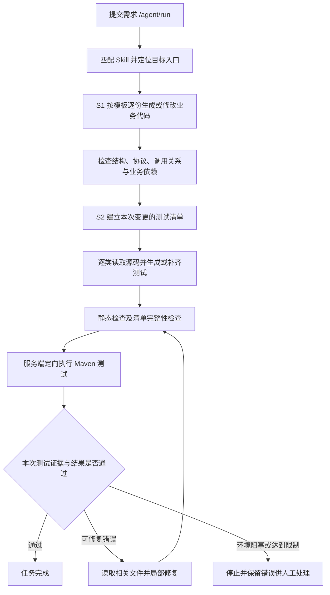

# S1 / S2 功能进展与下一期迭代计划

> 报告日期：2026-10-28  
> 项目：基于 Skill 和模板的目标工程代码自动生成与改造服务  
> 依据：当前实现、已有设计与实施记录，以及截至 2026-10-27 19:27:04 的本地运行日志。本文编写过程未重新编译、执行测试或发起模型调用。

## 一、汇报结论

项目已实现从“输入需求”到“定位目标工程、按模板生成或修改代码、生成测试、执行验证、失败后有界修复”的主流程。

- **S1：模板驱动的业务代码生成与改造已具备阶段性交付能力。** 已将一次性加载全部模板改为按模板顺序读取、实施和检查，支持已有文件局部修改及业务依赖补齐。最近一轮日志中，总览及五个实现模板全部完成。
- **S2：测试生成、定向执行与自动修复机制已接入，当前处于稳定性收敛阶段。** 最近一轮七个测试条目均完成结构检查；历史运行已实际执行过 53 个测试，但尚不能宣称完整自动修复闭环验收通过。
- **下一期优先完成 S2 稳定性和验收。** 保持 S1 模板约束，重点解决测试框架与依赖兼容、错误诊断和修复策略，随后优化上下文成本与结果展示。

### 可直接用于口头汇报

> 本阶段主要完成了代码自动生成流程的工程化改造。S1 已从依赖模型自由发挥，调整为按模板逐步实施，并增加代码结构、协议字段和依赖检查；已有文件使用局部补丁修改。S2 已实现逐类生成测试、由服务端统一执行 Maven、核验本次测试报告，以及失败后的有限轮次修复。目前模板生成主流程已经跑通，测试生成和执行能力也有实际运行证据，但测试依赖兼容和复杂初始化场景仍在收敛。下一期以跑通并稳定验证完整闭环为首要目标，再进一步降低模型调用成本、完善任务报告。

## 二、整体流程和职责划分



模型负责理解需求、生成修改计划和分析失败；文件操作、阶段推进、范围校验、Maven 执行及最终成功判定由服务端控制。模型不能在计划中自由执行 shell 或 Maven。

### 运行入口与环境

| 项目 | 当前能力 |
| --- | --- |
| 目标工程 | 通过 `codex.workspace.root` 指向待改造项目 |
| 模板与 Skill | 从生成器本项目读取，业务源码从目标 workspace 读取，避免混用路径 |
| 单任务入口 | `POST /agent/run` 异步提交，返回任务 ID；通过 `GET /agent/task/{taskId}` 查询 |
| 需求范围 | 以已匹配的业务 Skill 为入口，当前重点验证预测接口改造场景；未匹配需求不直接执行自动开发 |
| JDK 隔离 | 生成器使用 JDK 8，当前目标工程使用 JDK 11；`codex.agent.test-java-home` 仅影响目标 Maven 子进程 |
| 日志 | 阶段、模型调用、工具操作、Maven 输出及失败原因写入 `logs/mini-codex.log`；服务重启时覆盖旧日志 |

## 三、S1 已实现功能：按模板生成与改造业务代码

### 1. 按模板顺序实施

预测接口场景按照“总览 → 请求实体 → 配置 → HTTP 工具 → 调用 Handler → 业务入口”推进。先读取当前模板，完成对应产物并通过检查，再处理下一份模板；避免将所有模板一次性塞入模型上下文。

| 模板阶段 | 主要交付内容 |
| --- | --- |
| 请求实体 | 请求体、请求头和业务数据实体，明确字段类型及 JSON 协议映射 |
| 配置 | 接口地址、超时、连接池和重试等配置项及配置类 |
| HTTP 工具 | 统一 HTTP 调用、连接管理及公共追踪组件接入 |
| 调用 Handler | 请求构建、统一调用及响应结构解析 |
| 业务入口 | 在已有入口中接入调用链，并按固定方式写回结果字段 |

### 2. 模板要求通过检查落地

- 检查真实 package、同名类型、必需字段、方法及关键调用，不能仅靠模型声称完成推进阶段。
- 请求实体保留 `@JsonProperty` 映射；请求头 `isTestEvent` 固定为 `Boolean`，与布尔值调用一致。
- 自助设备地址使用 `SLF_EQP_ADR` 协议键，检查实体字段与 Handler 的真实 setter，防止拼写不一致或新增重复协议字段。
- HTTP 工具检查公共追踪类型、真实 Bean 字段、适配器与追踪调用，拒绝生成业务包中的公共组件替身。
- 入口保留固定调用链、响应取值和 `eventData.putDataAndOriginData` 写回方式。

这些属于静态结构与契约检查，能提前发现已知偏差，但不等价于完整 Java 编译、任意业务语义正确或生产可用性证明。

### 3. 已有文件局部修改

- 新文件确认不存在后创建；已有源码、配置和 POM 先读后使用局部补丁修改，不因文件存在就停止，也不直接整文件覆盖。
- 补丁旧文本必须匹配真实且唯一的内容；同一文件多个补丁按计划顺序预演，预检拒绝时不执行该计划。
- 补丁上下文不一致时提供真实内容摘录；针对匹配失败，可在任务内对相应文件安排一次确定性刷新读取。

### 4. S1 同步识别业务依赖

- 根据当前模板实际 import、模块 POM 和可访问的本地父链判断依赖缺项，不把已知缺包全部留给 S2。
- 使用 `.ai/dependency-mappings.properties` 提供公共包坐标及已知提供方线索，已覆盖 Jackson、Gson、HttpClient、Commons Lang、OpenTracing 等相关依赖。
- 区分实际依赖与 `dependencyManagement`；仅有版本管理、test/runtime 声明不能直接视为业务编译依赖已满足。
- 优先复用已有版本管理，只局部补入口模块 POM；未知私有依赖坐标或版本不能编造，父 POM 保持只读。

当前依赖判断以静态解析和明确映射为主，尚不等价于 Maven 完整有效配置及传递依赖解析。

## 四、S2 已实现功能：测试生成、执行与有界修复

### 1. 从本次变更建立测试清单

从当前任务成功修改的业务 Java 文件建立入口模块内的测试清单，逐类读取真实源码及已有测试，再生成或局部补齐当前测试。接口、抽象类等不适合作为独立条目的类型记录跳过理由。

已有测试可以复用和补齐，不要求无意义重写。当前清单以本次成功修改文件为基础，尚未覆盖任意跨模块影响分析。

### 2. 测试结构与修改范围保护

- 支持已有 JUnit 4/5 测试，检查真实包名、类名、业务类引用、测试方法及断言或交互验证。
- 拒绝空壳、禁用、assumption 跳过以及仅靠常量断言冒充有效测试。
- 修复时保护既有测试方法和断言，禁止删除或放宽断言制造通过。
- 外部 HTTP、数据库及私有服务优先使用 Mock 隔离，不要求连接真实外部服务。
- 测试依赖从模块 POM 局部补充；已补充 Mockito inline 能力、版本对齐及静态初始化测试隔离规则，实际兼容性仍需验收。

正常、异常、空值和需求分支覆盖已纳入生成规则；目前没有覆盖率指标证明所有业务分支均已覆盖。

### 3. 服务端定向执行 Maven

全部清单条目通过检查后，由服务端对固定模块及明确的测试类清单执行 Maven，不回退为无范围的全量测试。

- Maven 参数由系统构建，模型不能自由拼命令。
- 已处理旧版 Maven 不支持 `-ntp` 的兼容问题，保留异常链输出。
- 支持目标 JDK 配置、子进程编码统一、并发读取输出、执行超时及本次进程树清理逻辑。
- 编译或 POM 阶段失败时明确说明测试尚未启动，避免给每个测试类追加缺少报告的次生错误。

### 4. 以本次报告判定测试结果

通过运行前后文件指纹检查 Surefire XML 是否属于本次执行，逐个核实预期测试类的有效用例；旧报告、未执行、全跳过不能作为成功依据。

成功判定需要 S1 契约、测试清单、Maven 退出结果及本次有效测试证据共同满足。结论只覆盖当前模块指定清单，不代表目标项目全量回归通过。

### 5. 失败后的有限轮次修复

可修复错误进入 REPAIR，读取相关业务类、测试和 POM 后局部修改，再重新检查和执行。缺少工具、仓库鉴权及资源处理等环境阻塞及时停止，避免盲改业务。

| 控制项 | 当前配置或行为 |
| --- | --- |
| S2 开关 | `codex.agent.test-generation-enabled`，当前项目配置为 `true` |
| 总规划预算 | `codex.agent.max-model-calls`，当前 40 次，S1/S2 共用 |
| 修复轮数 | `codex.agent.max-repair-rounds`，当前 5 轮，可配置 0～10 |
| 单次测试超时 | `codex.agent.test-timeout-seconds`，当前 300 秒，可配置 30～1800 |
| 重复失败 | 同一错误且文件无实质变化时提前停止；连续规划失败也有停止保护 |
| 错误反馈 | 本次报告异常详情去重、控制台关键根因保留、摘要有界并脱敏 |

## 五、技术架构与关键实现方案

### 1. 技术组成及职责分工

整体采用“模型输出结构化计划，程序校验并执行，实际运行结果驱动修复”的方案。

| 技术点 | 实现方式 | 解决的问题 |
| --- | --- | --- |
| 服务与任务入口 | Spring Boot REST 接口，单任务异步执行并提供状态查询 | 避免多轮模型调用阻塞请求导致网关超时 |
| 阶段编排 | `AgentLoop` 配合 `AgentContext`、`AgentPhase`、`CodingTrack` | 分离分析、S1、S2、验证、修复和结束，防止未生成完就执行测试 |
| 模型规划 | `QwenPlanner` 组装需求、规则和文件观察，解析 JSON 工具计划 | 把自然语言需求转成可检查的具体文件操作 |
| 业务知识约束 | 项目业务 Skill 加 Markdown 分块模板 | 明确业务写法、模板顺序、固定协议及调用方式 |
| Java 静态解析 | JavaParser AST，结合必要的文本、配置及 XML 检查 | 检查真实类型、字段、方法、注解和调用，而非只搜索关键词 |
| 文件修改 | 工具白名单、workspace 路径约束、先读后改、唯一旧文本匹配及计划预演 | 控制修改范围，防止覆盖已有实现或使用过期内容 |
| 依赖识别 | import 解析、包名前缀坐标映射、模块及本地父 POM 解析 | 在 S1 提前发现已知公共依赖缺项 |
| 测试与执行 | JUnit 4/5、Mockito、Maven Surefire；服务端 `ProcessBuilder` 启动 Maven | 使用目标工程已有构建方式执行明确的测试清单 |
| 结果证据 | Surefire XML、安全 XML 解析、运行前后报告指纹 | 区分实际执行、旧报告、跳过、失败和通过 |
| 修复控制 | 错误反馈、文件最新读取、契约重验、修复上限与重复失败保护 | 避免无限修复和通过破坏业务约束来迁就测试 |

### 2. Skill、模板、执行计划与测试清单的区别

| 概念 | 当前含义 | 由谁维护或生成 |
| --- | --- | --- |
| 业务 Skill | 业务匹配条件、目标入口、规则及模板路径，例如 `predict-api` | 项目维护者配置 |
| 模板 | 业务代码结构、字段映射、配置与调用示例 | 项目维护者配置 |
| 工具执行计划 | 本轮需要调用哪些工具、修改哪个文件、使用什么补丁 | 模型生成，程序校验 |
| S2 测试清单 | 本次需生成或补齐哪些类的测试，以及条目进度 | 程序从任务变更记录建立 |
| 测试用例 | 测试方法、输入数据、Mock 和断言 | 模型根据需求、真实源码及规则生成 |

**当前测试计划并不是独立 Skill。** 通用测试生成规则由 S2 程序提供，业务 Skill 主要约束 S1。后续可以把业务专属验收场景写进 Skill，但清单推进、测试执行与成功判定仍由程序负责。

### 3. S1 顺序生成与校验方案

1. 匹配业务 Skill，搜索并读取真实目标入口，确定包路径和所属模块。
2. `SkillTemplateCoordinator` 确定当前模板，并保留总览、当前模板及当前产物的必要上下文。
3. 模型生成当前模板的工具计划；程序检查阶段、路径、已有文件读取状态及补丁匹配情况。
4. 工具执行后，`TemplateContractValidator` 检查实际落盘产物，`MavenDependencySupport` 检查相关业务依赖。
5. 检查通过后将模板记入 `completedTemplates`；不通过则反馈具体缺项，继续处理当前模板。

不是“读取过模板就完成”，也不是“模型返回空计划就完成”；阶段由程序依据产物和契约推进。现有模板检查包含场景特定规则，并非任意模板均能自动推导出完整约束。

### 4. 测试生成的数据来源与上下文方案

测试生成依据是“原始需求 + 当前真实业务源码 + 已有测试 + 模块依赖 + S2 生成规则”，修复阶段再加入具体失败信息。

```text
S1 成功的文件操作
    ↓ 记录路径、工具输入、结果和成功状态
当前任务 AgentContext.observations
    ↓ 提取入口模块 src/main/java 内的本次变更，规范化路径并去重
S2 测试清单：source / sourceClass / test / testClass / complete
    ↓ 按当前条目读取实际文件，检查已有读取是否仍匹配磁盘内容
当前业务源码 + 已有测试 + 模块 POM + 原始需求与生成规则
    ↓ 模型生成 JSON 工具计划
生成或局部补齐测试 → AST 检查 → 推进下一条目
```

S1 的变更记录用于确定“测哪些类”，不把旧的生成响应直接视为最终源码。S2 会读取磁盘中的实际实现，并将读取结果作为模型观察上下文。相关状态保存在当前任务上下文中，不是另建一份测试计划数据库。

`QwenPlanner` 在 S2 优先保留当前清单条目的源码、测试和 POM 观察，结合少量最近操作；文件内容超限时标记截断，要求补读。REPAIR 根据错误涉及的类保留相关文件，不一次性重新加载全部业务模板。

**当前不足：测试仍主要由实现代码驱动，尚无独立的需求验收用例清单。** 即使模型看到了原始需求，也可能按错误实现生成自洽测试。下一期应建立“需求验收场景 → 测试用例 → 执行证据”的对应关系；源码提供真实签名和调用方式，验收场景提供预期结果。

### 5. Java 导包与 Maven 依赖解析方案

当前采用“模板与模型补 import + 程序查映射及已有声明 + Maven 实际验证”的协作方式，不完全依赖模型推理，也不是完整的 IDE 符号解析器。

| 问题 | 当前处理方式 |
| --- | --- |
| 某个类型应使用哪个 Java import | 优先依据模板中的公共类型和已读目标源码，由模型补齐；部分固定公共类型有专门契约检查 |
| import 所属的 Maven 坐标 | 程序解析实际 Java import，按最长包名前缀匹配 `.ai/dependency-mappings.properties` |
| 模块是否已经具备依赖 | 解析入口模块及 workspace 内可访问的本地父 POM，检查直接/继承声明、scope 和已知提供方 |
| 缺少依赖如何修改 | 将缺项及候选坐标反馈模型，由模型基于已读 POM 生成局部补丁 |
| 版本如何确定 | 优先已有版本、properties、父 POM/BOM 管理；未知版本或私有坐标必须有依据 |
| 最终是否可用 | Maven 根据实际构建配置解析依赖并编译，验证类型及方法能否解析 |

例如实际源码出现：

```java
import org.apache.commons.lang3.StringUtils;
```

程序可匹配已维护的映射：

```properties
org.apache.commons.lang3.=org.apache.commons:commons-lang3
```

若适用依赖已存在则复用；若缺失则要求局部补模块 POM。部分映射包含多个已知提供方，表示存在适用提供方时可复用，不是全部添加。

技术边界：静态检查不解析完整远程 BOM、所有传递依赖和激活 profiles；只在 `dependencyManagement` 中声明坐标不能视为实际引入。映射外公共包及私有包仍需根据项目资料分析，不能从 Java 包名直接猜 Maven 坐标。S2 测试依赖目前主要依赖生成规则、模型分析及实际错误反馈，尚未形成与 S1 同等完整的自动检查。

### 6. 为什么使用 Maven，以及谁判断测试通过

目标工程本身使用 Maven，因此直接复用 POM 中的编译、依赖和 Surefire 配置。Maven 的作用是统一、可重复地组织构建和执行，测试质量仍由需求场景、断言及 Mock 的正确性决定。

- **JUnit** 执行测试方法和断言。
- **Mockito** 隔离外部依赖及指定对象行为；静态、构造器 Mock 需要实际 MockMaker 支持。
- **Maven / Surefire** 组织编译和测试执行，输出退出码及结构化测试报告。
- **服务端程序** 根据退出码、新报告、预期测试类和有效用例判定结果。
- **模型** 接收失败详情，提出业务代码、测试或依赖的修复计划，不拥有最终成功判定权。

服务端命令形态如下，仅用于说明当前方案，本文未执行该命令：

```text
mvn -B -e test -Dtest=<本次测试类全名清单>
    -DfailIfNoTests=true -Dsurefire.failIfNoSpecifiedTests=true
    -DskipTests=false -Dmaven.test.skip=false -Dmaven.test.failure.ignore=false
    -Dstyle.color=never
```

运行前保存报告时间、长度和内容哈希等指纹，运行后核对新报告。指定类没有本次有效执行证据，即使退出码为零也不能报成功；模型声称“已经修复”同样不能替代重新执行。

### 7. 错误反馈、修复与资源控制

失败信息来自静态检查、Maven 输出和本次 Surefire XML。程序对已知命令参数、POM、资源阶段、编译和测试失败分别处理；环境阻塞停止，允许修复的问题反馈给模型。

报告异常类型与消息按有界长度提取并去重，MockMaker 等没有 Maven ERROR 前缀的关键信息单独保留；避免模型只看到“某用例失败”而缺少根因。修复后先重新检查 S1 契约及 S2 测试结构，再执行测试。

Windows 通过监督进程管理 Maven，生成器使用 JDK 8 兼容的进程 API；读取线程持续消费输出，避免输出管道阻塞。目标 JDK 通过子进程环境设置，不修改生成器运行基线或全局 Java 环境。超时和中断只清理本次进程树。

测试清单、文件、报告和日志摘要均有边界：最多 200 个源码条目、单个源码文件 256 KiB/10000 行、最多 200 份报告且每份 1 MiB、模型错误摘要最多 8 KiB；同时受总模型预算和修复轮数限制。这些是控制成本和异常资源占用的措施，不代表已有成本优化目标全部达成。

## 六、当前进展与运行证据

| 能力 | 实现状态 | 当前证据与结论 |
| --- | --- | --- |
| S1 顺序模板与产物检查 | 已实现，已有场景运行证据 | 最新日志总览及五个实现模板均完成 |
| S1 业务生成与局部修改 | 已实现，已有场景运行证据 | 已进入 S2；历史运行中业务源码已通过编译，不等于所有场景验证完成 |
| S2 逐类测试生成 | 已实现，已有清单完成证据 | 最新日志七个条目达到 7/7；这是结构完成，不是七类测试运行成功 |
| S2 定向测试执行与报告识别 | 已实现，已有实际执行证据 | 前轮日志实际执行 53 个用例，35 个通过、18 个报错、0 跳过 |
| S2 自动修复与重新验证 | 主机制已实现，稳定性待收敛 | 已观察到失败后进入修复、重测和保护停止；尚无完整任务最终全通过证据 |
| Mockito 根因反馈改进 | 代码已落地 | 已补全异常详情及修复方向；后续运行仍需验证策略有效性 |

### 最新一轮状态：2026-10-27 19:19～19:27

1. S1 总览及五份实现模板完成。
2. S2 七个测试条目完成结构检查。
3. Maven 在测试源码编译阶段失败，出现 `Test` 等注解无法解析；该轮尚未实际执行测试。
4. 模型随后尝试给已有 `mockito-inline` 声明补版本，被“不得改变已有依赖”的保护规则拒绝，最终在第 17 次规划调用后停止。

本轮反映出测试框架依赖识别和修复许可仍需完善。不能仅凭模型描述认定根因是 Mockito 缺版本；需要结合真实测试 import、模块 POM、父级版本管理和编译诊断确认。

### 当前尚不能承诺的事项

- 任意自然语言需求均可自动开发；当前能力受已配置 Skill 和模板覆盖范围约束。
- 所有模板语义和业务分支均被静态检查或测试完全覆盖。
- 每次任务都能在预算内自动修复到通过。
- 多模块、真实外部系统集成和目标项目全量回归已经验收。

## 七、下一期迭代计划（建议）

下一期围绕现有预测接口场景收敛，不优先扩展更多模板或提高模型调用预算。

| 优先级 | 工作项 | 计划内容 | 验收标准 |
| --- | --- | --- | --- |
| P0 | 测试依赖与框架一致性 | 检查生成测试的 JUnit import 与实际依赖，识别 Mockito core/inline 版本依据；设计有证据的缺失依赖及版本修复许可 | 不再出现框架混用后盲补依赖；合法修复能执行，已有版本无依据升级仍被拒绝 |
| P0 | 修复策略准确性 | 按业务编译、测试编译、Mock 能力、断言和环境故障分类；优先修根因，限制修改范围 | Mock 能力错误优先修测试配置，不删除生产初始化；重复错误能给出明确停止原因 |
| P0 | 需求验收用例约束 | 从需求和业务 Skill 明确输入、预期结果及异常场景，再关联到测试方法；与实际源码签名对齐 | 代表性需求的验收场景均有对应测试和执行结果，避免仅验证实现自身行为 |
| P0 | 完整闭环验收 | 固定需求和目标工程状态，验证已有文件改造、测试补齐、失败修复与重测 | 至少一个代表性需求达到最终成功，所有清单测试有本次报告且无失败；错误场景能正确停止 |
| P1 | S1 契约持续完善 | 将验收发现的字段、调用及依赖偏差补充为可复用检查，保持逐模板实施 | 已知模板偏差能在进入测试执行前被发现，已有业务逻辑和注释保持完整 |
| P1 | 上下文与调用成本 | 分析当前 prompt、重复读取及失败重试，缩减无关历史，保留当前模板和错误相关文件 | 固定场景记录调用数、输入输出 Token、耗时及失败轮数，与基线比较，不以减少必要检查换成本 |
| P1 | 任务结果报告 | 汇总修改文件、模板进度、测试统计、修复记录、未完成项及人工处理建议 | 业务使用者能直接区分生成完成、编译通过、测试通过和环境阻塞 |
| 后续 | 模板与场景扩展 | 在闭环稳定后再评估新增业务 Skill、多模块和集成验证 | 每个新场景有独立模板契约、依赖依据及验收样例，不直接扩大现有承诺范围 |

建议实施顺序：**先解决当前测试编译与依赖修复阻塞 → 完成代表场景闭环验收 → 形成稳定性与成本基线 → 再扩展场景。** 具体排期在确定人力和验收样例后安排。

## 八、建议汇报的指标

后续每轮验收固定记录以下指标，避免只以“生成了多少文件”衡量完成度：

- S1：模板完成数、契约拒绝次数、依赖补齐次数，以及进入 S2 前的生成质量。
- S2：清单条目数、实际执行/通过/失败/跳过用例数，以及报告新鲜度。
- 闭环：首次验证通过率、自动修复成功率、平均修复轮数和人工介入原因。
- 效率：端到端耗时、模型调用次数及输入输出 Token。

现有日志可支撑部分指标的人工统计，统一看板与自动统计不计入本期已完成功能。

## 九、主要实现位置与参考资料

| 模块 | 主要文件 |
| --- | --- |
| 任务入口与状态查询 | `src/main/java/com/cmbchina/llm/controller/AgentController.java` |
| 阶段编排与修复循环 | `src/main/java/com/cmbchina/llm/runtime/AgentLoop.java` |
| 规划、规则和补丁预检 | `src/main/java/com/cmbchina/llm/planner/QwenPlanner.java` |
| S1 模板推进及契约 | `src/main/java/com/cmbchina/llm/planner/SkillTemplateCoordinator.java`、`TemplateContractValidator.java` |
| Maven 业务依赖识别 | `src/main/java/com/cmbchina/llm/planner/MavenDependencySupport.java`、`.ai/dependency-mappings.properties` |
| S2 清单与测试门禁 | `src/main/java/com/cmbchina/llm/planner/S2TestCoordinator.java`、`src/main/java/com/cmbchina/llm/verify/TestSourceInspector.java` |
| 验证、执行与测试证据 | `src/main/java/com/cmbchina/llm/verify/VerifyEngine.java`、`SurefireReportReader.java`、`src/main/java/com/cmbchina/llm/tool/RunTestTool.java` |
| 业务模板与规则 | `docs/predict-call-template-parts/`、`.ai/skills/predict-api/skill.md` |
| 历史设计与实施记录 | `docs/superpowers/specs/2026-10-20-s2-test-repair-design.md`、`docs/superpowers/plans/2026-10-20-s1-dependencies.md`、`docs/superpowers/plans/2026-10-20-s2-implementation.md` |

本文仅整理现状和建议计划，不包含代码修改、新增测试或额外执行环境操作。
